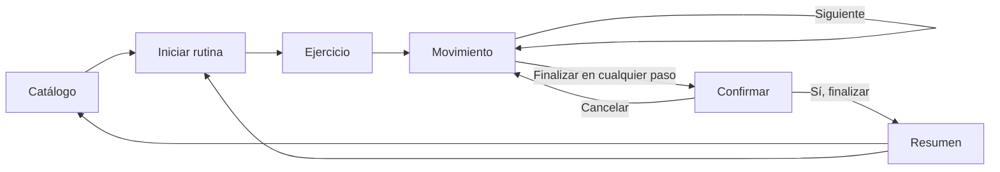
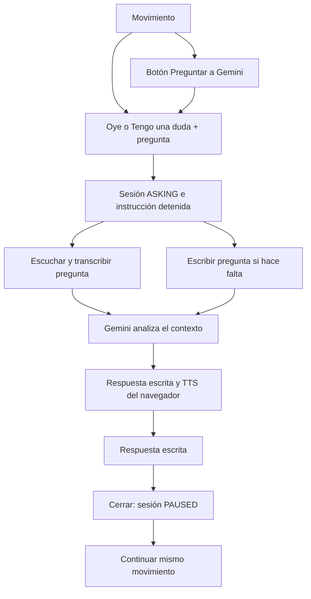

# Flujos de usuario

La selección crea una sesión persistida en MySQL y abre el primer movimiento. La voz comienza cada movimiento con su nombre seguido de la primera instrucción: «En Acariciar la Crin del Caballo, imagina que sostienes una pelota grande frente al cuerpo». Las esperas entre instrucciones se limitan a 1.5 segundos. Al terminar las instrucciones y los consejos pendientes, la práctica avanza automáticamente al siguiente movimiento mientras siga en reproducción. Pausar, preguntar o consultar ayuda interrumpe ese avance. El usuario también puede controlar la práctica con botones o con «Pausar», «Continuar», «Repetir», «Siguiente» y «Anterior». Al terminar el último movimiento se solicita confirmación para finalizar; cancelar conserva el paso y no vuelve a abrir la confirmación automáticamente. «Finalizar» también abre la confirmación desde cualquier tarjeta. «Sí, finalizar» o el botón de confirmación abre el resumen. Cuando se finaliza antes del último movimiento, el resumen muestra el paso alcanzado. Si falla el avance automático, se muestra un aviso y se puede reintentar con «Siguiente».

El usuario dice «Oye» o «Tengo una duda» seguido de su pregunta; el navegador la transcribe y la envía a Gemini automáticamente. Una activación aislada espera la pregunta durante diez segundos. Puede usar el botón, detener la escucha o escribir si el micrófono falla. Mientras Gemini procesa y narra, se pausan la guía y la escucha de comandos. Al terminar, «Continuar» por voz cierra el panel y reanuda la rutina. Gemini recibe contexto validado por el servidor y la pregunta/respuesta se guarda en la sesión. La tarjeta permite repetir la narración. Cerrar conserva movimiento y tiempo. Si la respuesta falla, el texto permanece editable para reintentar. Si falla TTS, la respuesta escrita se mantiene y se comunica el fallo de audio.

## Otros recorridos

La bienvenida solo saluda e invita a elegir una rutina. La primera práctica presenta los comandos esenciales y los dos modos del micrófono. Los demás consejos aparecen al avanzar, pausar, llegar al último movimiento o activar Pulsar para hablar. Cada explicación se puede omitir y se recuerda entre visitas en el mismo navegador.

«Ayuda» o «Necesito ayuda» abre el diálogo y responde «¿En qué te puedo ayudar?». «Cuáles eran los comandos» muestra la lista por temas y da una orientación breve. El usuario elige qué tema escuchar; puede detenerlo o solicitar la lista completa. El botón «Ayuda» junto al micrófono abre este diálogo; dentro se muestra el modo activo y se puede cambiar. La guía del movimiento espera durante la consulta. «Continuar» permite volver a la práctica; cerrar la ayuda recupera el estado anterior.

La práctica inicia en escucha continua. «Aplica el modo Pulsar para hablar» cambia el modo y confirma la acción en texto y voz. En ese modo el icono del micrófono inicia una captura; una segunda pulsación solicita la transcripción final. Tras cada frase vuelve a esperar otra pulsación. Para regresar, el usuario pulsa el icono y dice «Cambia a escucha continua» o «Activa escucha continua». El diálogo de ayuda también permite cambiar entre los dos modos con un botón. La confirmación de finalizar y la respuesta de IA ofrecen controles para responder o decir «Continuar» en el modo elegido.

Una transcripción provisional exacta de «Pausar» detiene el audio y muestra «Confirmando…», sin cambiar todavía la sesión. La transcripción definitiva ejecuta la pausa una sola vez. Si cambia la frase o pasan cuatro segundos sin confirmación, la guía retoma la frase que estaba narrando. Mientras el servidor aplica un comando se muestra «Aplicando…» y se impiden comandos simultáneos. Si falla la pausa, la guía se recupera y aparece un aviso. Los resultados provisionales nunca finalizan la práctica.

Las mediciones locales de reconocimiento, interrupción del audio y aplicación de comandos están documentadas en [Control por voz](VOICE_CONTROL.md).

- **Pausa y continuar:** `PLAYING → PAUSED → PLAYING`; al continuar se vuelve a narrar completa la instrucción donde se pausó y después siguen las siguientes. «Repetir» reinicia todas las instrucciones del movimiento.
- **Repetir:** vuelve a solicitar lectura de la instrucción actual sin tocar índice, progreso o tiempo.
- **Regresar:** retrocede un movimiento si existe; el tiempo total no se reinicia.
- **Abandonar:** acción explícita desde práctica, con confirmación del navegador; se limpia sesión y se vuelve al catálogo.
- **Entrada vacía:** el botón permanece deshabilitado y no se llama al proveedor.
- **LLM fallido o sin cuota:** mensaje claro del backend, sesión en `ASKING`, se puede editar, reintentar o cerrar.
- **TTS fallido:** mostrar respuesta y aviso; seguir con texto.
- **Ruta inválida:** mensaje y enlace a rutinas; una ruta de práctica sin sesión redirige al catálogo.
