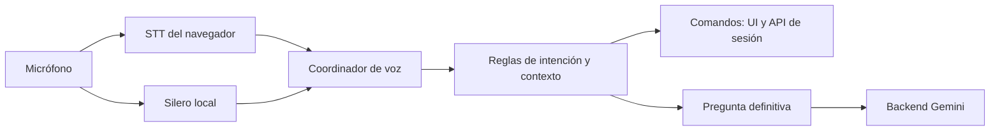
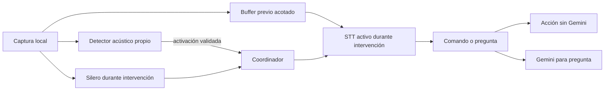

# Plan de mejora del control por voz de Taichi

Fecha de investigación: 14 de octubre de 2026. Última actualización: 17 de octubre de 2026. Rama de implementación: `feat/Voice-improvement`. Estado: VOZ-01–04 implementados; base técnica de VOZ-05–07 implementada detrás de modos opt-in. Baseline y decisión de adopción con micrófono real pendientes.

## Avance de implementación

- VOZ-01: evaluación opcional en memoria, límite de 1000 eventos, exportación JSON y percentiles separados por origen de medición/resultado. Los adaptadores registran ciclo de captura y resultados sin guardar texto. Falta ejecutar el protocolo real y obtener el baseline por dispositivo.
- VOZ-02: comandos completos después de activación y variantes «paúsalo», «continúa», «repite». Una activación separada seguida de comando también usa la acción de sesión; finalizar conserva confirmación definitiva.
- VOZ-03/04: base del coordinador de captura implementada y compartida por escucha de comandos y preguntas. Propiedad exclusiva, invalidación de callbacks/timers tardíos, cancelación inmediata y cierre gracioso continuo con espera acotada. Cola compartida por voz y botones, con ejecución en orden después de aplicar el estado anterior. «Pausar» corta el audio inmediatamente y espera su turno de actualización; suprime reinicios de narración mientras espera. Espera de cola y ejecución se miden por separado.
- Políticas de cola confirmadas por el usuario: un fallo detiene y descarta los comandos pendientes, pidiendo repetirlos; abrir la confirmación de finalizar también los descarta. Salir de la pantalla invalida la ejecución local y descarta la espera. Límite de diez acciones más un lugar reservado para pausa; la saturación muestra aviso. Las pruebas cubren HTTP retrasado, límites de movimiento, repetición deliberada y deduplicación del mismo resultado.
- VOZ-05: `@ricky0123/vad-web` 0.0.31 y `onnxruntime-web` 1.22.0 fijados; modelo v6, worklet y WASM se copian de forma reproducible y se sirven sin CDN.
- VOZ-06/07: modos `off`, `observe` y `endpoint`, perfiles separados, instancia diferida compartida, ownership/cancelación y cierre gracioso probados con dobles. `off` sigue predeterminado; falta medir audio, eco, CPU y precisión reales antes de adoptar `endpoint`.
- VOZ-08–12: pendientes de la matriz física, corpus/modelo español y decisiones posteriores. El límite común de cinco segundos sigue siendo una espera de finalización, no un umbral VAD.
- Deudas detectadas y resueltas: `npm run build` fuerza entorno de producción sin modificar `.env`; la prueba de ayuda espera la transición de pausa y sus efectos con `act` asíncrono y verifica la reanudación después del fin de la narración. La interfaz de diagnóstico está ausente del bundle de producción.
- Método de baseline elegido: consola del navegador documentada, sin añadir un panel de diagnóstico.
- Primera muestra real: Edge/escritorio, ocho comandos y ninguna entrada descartada. Se corrigió el doble corte provisional/definitivo y se separaron métricas por comando, HTTP y etapas de servidor. Tras autorización del usuario se eliminaron escritura intermedia de tiempo, conteos y lectura de preguntas innecesarios: mejora exploratoria de 22–54 % según acción, con demora residual de 1,26–1,82 s en el camino de base de datos externa/de red. El usuario reportó pérdida de reconocimiento tras comandos rápidos y confirmó el aviso que corresponde al HTTP 429 de Gemini clasificado como límite temporal; falta nueva captura del fallo de escucha. Ver [Medición HTTP y correcciones](VOICE_HTTP_FINDINGS.md). El 17 de octubre el usuario autorizó completar el incremento pendiente de recepción; Silero quedó disponible como experimento opt-in sin cambiar todavía el valor predeterminado.

El procedimiento para iniciar y exportar mediciones en desarrollo está en [Control por voz](VOICE_CONTROL.md). No interpretar las pruebas con reconocimiento simulado como medición de latencia o precisión acústica real.

## Decisión y alcance

Implementar por etapas: medición → enrutamiento de comandos → coordinación de la captura → Silero VAD → activación acústica independiente en español → evaluación de cierre semántico. La preferencia del proyecto es mantener la solución **sin Picovoice/Porcupine**.

La primera entrega se apoya en el reconocimiento del navegador y puede empezar sin entrenar modelos. La segunda busca que el STT deje de transcribir durante la espera, utilizando un detector acústico propio. Esa segunda entrega exige resolver entrenamiento en español, eco y conservación del comienzo de la frase. No se presenta openWakeWord como una dependencia lista para instalar y usar en esta aplicación web.

Objetivos:

- Responder más rápido a comandos y reducir consultas accidentales a Gemini.
- Cerrar intervenciones con menos espera, sin recortar preguntas o descartar comandos breves.
- Mantener la posibilidad de interrumpir la guía durante los movimientos.
- Reducir la actividad del STT durante la espera cuando exista una alternativa acústica validada.
- Conservar controles táctiles, teclado, entrada escrita y pulsar para hablar.

La escucha permanente se entiende dentro de una página de práctica activa y con permiso de micrófono. No se promete funcionamiento con la aplicación cerrada, dispositivo bloqueado o pestaña suspendida. El detector local no elimina las restricciones del navegador.

## 1. Estado real del proyecto

| Pieza                                                  | Comportamiento encontrado                                                                                          | Consecuencia para la mejora                                                     |
| ------------------------------------------------------ | ------------------------------------------------------------------------------------------------------------------ | ------------------------------------------------------------------------------- |
| `src/infrastructure/ai/ContinuousSpeechRecognition.ts` | `SpeechRecognition`/`webkitSpeechRecognition`, español `es-MX`, resultados provisionales y definitivos, reconexión | Actualmente el navegador controla la transcripción y su finalización            |
| `src/presentation/hooks/useContinuousVoiceControl.ts`  | Modos continuo y pulsar para hablar; suspensión y apagado                                                          | Ambos modos deben conservarse; no abrir una captura por cada render             |
| `src/infrastructure/ai/BrowserSpeechToTextAdapter.ts`  | Captura independiente para el panel de preguntas                                                                   | Hay dos caminos de STT que deben coordinarse antes de añadir VAD                |
| `src/application/voiceIntent.ts`                       | Reglas exactas para siete comandos; activación textual «Oye»/«Tengo una duda»                                      | El bypass de Gemini ya existe; hace falta cubrir activación seguida de comando  |
| `src/presentation/pages/PracticePage.tsx`              | «Pausar» provisional corta la narración; resultado definitivo confirma la transición                               | Mantener la respuesta inmediata reversible y la recuperación si el texto cambia |
| `src/app/SessionProvider.tsx`                          | Pausa, avance y otras transiciones se persisten mediante HTTP                                                      | Bypass del LLM no significa acción íntegramente local ni latencia cero          |
| `src/application/voiceLatency.ts`                      | Últimas veinte muestras y Performance API: reconocimiento, corte de audio y acción                                 | Útil para diagnóstico; insuficiente para una evaluación amplia de percentiles   |
| `server/geminiService.ts`                              | Gemini recibe texto y contexto del movimiento                                                                      | VAD y comandos no requieren añadir consumo de Gemini                            |
| `server/app.ts`                                        | Preguntas validadas y cuota por sesión                                                                             | Evitar pruebas de voz que envíen consultas reales innecesarias                  |

Detalles que corregir:

1. «Pausar» va al comando, pero «Oye, pausar» entra como pregunta, salvo el tratamiento especial de ayuda. El prefijo de activación debe retirarse antes de volver a comprobar el catálogo de comandos.
2. No hay un timeout configurable de silencio de 1.5 segundos en el código actual. Los límites de 12 segundos por pulsación, 5 segundos para esperar el resultado al terminar y 10 segundos después de «Oye» cumplen otras funciones. No deben sustituirse todos por 500 ms.
3. `finishUtterance()` solo actúa actualmente en pulsar para hablar. El cierre por VAD necesita una operación específica que también sirva en continuo y espere el resultado final antes de rearmar la escucha.
4. La escucha permanece activa durante partes de la narración de movimientos. No basta con suspenderla durante cualquier TTS: eso impediría que el usuario interrumpiera la guía.
5. La confirmación de finalizar tiene un contexto propio. «Sí» y «Cancelar» no deben actuar fuera de ese contexto.

## 2. Investigación y decisiones técnicas

### Silero en navegador

Silero dispone de modelos ONNX. La ruta propuesta es `@ricky0123/vad-web` con ONNX Runtime Web, sin servicio Python en producción. El benchmark del proyecto informa menos de 1 ms por fragmento de más de 30 ms en sus condiciones; ese dato no mide la respuesta completa de Taichi ni garantiza ese rendimiento en un móvil. [Fuente: Silero](https://github.com/snakers4/silero-vad).

La guía de modelos recomienda seleccionar explícitamente `model: 'v6'`; v5/v6 procesan ventanas de 512 muestras, equivalentes a 32 ms a 16 kHz. Comparar v5 si v6 presenta incompatibilidades o peores resultados reales. [Fuente: modelos de vad-web](https://docs.vad.ricky0123.com/user-guide/models/).

La biblioteca expone `onSpeechStart`, `onSpeechEnd`, `onVADMisfire`, ajustes de duración y provisión de un `MediaStream`. Su pausa detiene las pistas por defecto: un coordinador que comparta captura debe definir expresamente quién las detiene. [Fuente: API de vad-web](https://docs.vad.ricky0123.com/user-guide/api/).

VAD distingue actividad de voz; no identifica al usuario, la palabra de activación ni la intención. La voz de la narración, de otra persona o de una televisión puede considerarse habla.

### Dependencias y assets

El `package.json` upstream consultado declara `@ricky0123/vad-web` 0.0.31, licencia ISC y dependencia `onnxruntime-web` con rango `^1.17.0`. Esto describe el repositorio consultado, no verifica por sí solo qué paquete publicado contiene todos los assets v6. Antes de instalar, revisar el artefacto publicado y fijar las versiones exactas que superen el prototipo. [Fuente: package.json upstream](https://raw.githubusercontent.com/ricky0123/vad/master/packages/web/package.json).

Servir desde el propio sitio el modelo elegido, worklet, WASM y bindings `.mjs`, con rutas que funcionen en desarrollo y en `dist`. Configurar `baseAssetPath` y `onnxWASMBasePath`; no depender de rutas CDN predeterminadas. Usar copia reproducible durante desarrollo/build, mediante un script pequeño o `vite-plugin-static-copy` compatible con Vite 8. [Fuente: integración con Vite](https://docs.vad.ricky0123.com/user-guide/browser/).

Empezar con un hilo WASM. El multihilo requiere soporte del navegador y `crossOriginIsolated`; no introducir COOP/COEP antes de necesitarlo. Comprobar las rutas WASM y la coincidencia entre JavaScript y binarios de la versión instalada. Evaluar un Worker de inferencia si las mediciones muestran bloqueo de UI; un AudioWorklet de captura no implica que toda la inferencia ya se ejecute fuera del hilo principal. [Fuente: ONNX Runtime Web](https://onnxruntime.ai/docs/tutorials/web/env-flags-and-session-options.html).

### Límites del STT nativo

`recognition.stop()` deja de recibir audio e intenta producir un resultado con lo capturado. No equivale a obtener una transcripción definitiva inmediatamente. Usar `abort()` al cancelar, no al cerrar una frase que debe conservarse. [Fuente: stop()](https://developer.mozilla.org/en-US/docs/Web/API/SpeechRecognition/stop).

Los provisionales pueden cambiar o desaparecer en eventos posteriores. Un comando provisional solo autoriza efectos reversibles; un resultado final autoriza una transición persistente, siempre que el estado de la sesión lo permita. [Fuente: resultados de reconocimiento](https://developer.mozilla.org/en-US/docs/Web/API/SpeechRecognitionEvent/results).

En algunos navegadores el reconocimiento usa un servicio remoto. Añadir VAD local no vuelve automáticamente local al STT. [Fuente: SpeechRecognition](https://developer.mozilla.org/en-US/docs/Web/API/SpeechRecognition).

`start(audioTrack)` permite pasar una pista, pero su soporte es limitado: los datos MDN consultados indican Chrome de escritorio desde 135 y Edge por equivalencia; no Chrome Android, Firefox ni Safari. El funcionamiento del audio previo debe verificarse con una prueba real, no con `start.length` o un `try/catch`, porque un navegador podría ignorar el argumento. [Fuentes: start()](https://developer.mozilla.org/en-US/docs/Web/API/SpeechRecognition/start), [compatibilidad MDN](https://github.com/mdn/browser-compat-data/blob/main/api/SpeechRecognition.json).

### Activación independiente sin Picovoice

| Candidato                     | Evidencia                                                                                                                                                          | Decisión                                                                                                       |
| ----------------------------- | ------------------------------------------------------------------------------------------------------------------------------------------------------------------ | -------------------------------------------------------------------------------------------------------------- |
| openWakeWord                  | Su documentación declara soporte en inglés y trabajo de portabilidad pendiente para JavaScript. Código Apache-2.0; modelos preentrenados incluidos CC BY-NC-SA 4.0 | Candidato de investigación para entrenamiento propio, no motor predeterminado de producción                    |
| TensorFlow.js Speech Commands | Inferencia y transferencia de aprendizaje en navegador; vocabulario base en inglés                                                                                 | Primer experimento de integración web para un vocabulario propio; validar español, ventanas de frase y consumo |
| Porcupine                     | Soporta español y web, pero requiere Picovoice                                                                                                                     | Excluido por preferencia del proyecto                                                                          |

[Fuente: openWakeWord, idioma, navegador y licencias](https://github.com/dscripka/openWakeWord). [Fuente: Speech Commands y entrenamiento por transferencia](https://github.com/tensorflow/tfjs-models/blob/master/speech-commands/README.md).

El experimento TensorFlow.js no presupone que un modelo inglés funcione bien en español. Su ventana de entrada y el preprocesamiento deben admitir la duración completa de «Oye Taichi»; de lo contrario se necesita un modelo/preprocesamiento propio. Tampoco se incorpora un segundo runtime a producción antes de demostrar que ofrece mejor consumo que la alternativa.

No enviar audio permanente a un backend Python remoto para poder llamarlo «local». Un auxiliar instalado en la computadora sería otra arquitectura y no forma parte de la aplicación web propuesta.

### Cierre semántico

Separar dos problemas:

- **Comandos de catálogo:** reconocer una frase admitida, permitir feedback provisional reversible y cerrar con VAD. No necesita un modelo semántico general.
- **Preguntas libres:** determinar cuándo la persona terminó requiere más contexto y un STT que permita controlar audio/transcripciones. Una oración completa puede continuar o corregirse. La puntuación provisional no es prueba suficiente.

La primera entrega usará reglas y VAD. Un detector semántico para preguntas será una evaluación posterior; no añadiremos un LLM por cada fragmento ni enviaremos audio a Gemini en espera. El STT y el modelo de endpointing de esa etapa se elegirán con una comparación específica de español, costos, hardware y compatibilidad.

## 3. Arquitectura de las entregas

### Entrega A: mejorar el flujo actual

En esta entrega VAD y STT observan audio simultáneamente. Permite probar un cierre más temprano, pero añade procesamiento local y no reduce por sí sola el tiempo del STT en espera. La captura interna del STT nativo puede ser independiente del `MediaStream` de VAD; no prometer un único stream hasta validar `audioTrack`.

### Entrega B: STT bajo demanda

El objetivo de espera es KWS local activo, STT detenido y cero consultas Gemini. Mantener Silero también en espera solo si mejora los falsos positivos con un costo medido aceptable; evitar ejecutar dos modelos continuamente sin beneficio demostrado.

Hay dos rutas de producto posibles tras la evaluación:

1. Activación para todo: «Oye Taichi, siguiente». Requiere enseñar el prefijo también para comandos.
2. Activación más comandos acústicos directos: el modelo local detecta «Pausar», «Continuar», etc., y abre STT solo para preguntas. Conserva la interacción actual, pero aumenta entrenamiento y validación.

La ruta 2 es el objetivo de compatibilidad. Si no alcanza precisión suficiente, conservar el modo continuo actual y ofrecer el modo con activación como opción explícita; no cambiar silenciosamente el significado de «Pausar».

## 4. Coordinador y contratos

Introducir una máquina de voz separada del estado persistente de práctica:

| Estado de voz     | Responsabilidad                                                              |
| ----------------- | ---------------------------------------------------------------------------- |
| OFF               | Sin pistas ni inferencia; recursos destruidos cuando corresponda             |
| INITIALIZING      | Preparar modelo y runtime, sin aceptar comandos todavía                      |
| IDLE              | Espera continua actual o detector acústico, según estrategia                 |
| CAPTURING         | Intervención con identificador único y perfil de silencio                    |
| FINALIZING        | `stop()` solicitado una vez; esperar final/end o watchdog                    |
| EXECUTING         | Ejecutar una acción una vez; bloquear repeticiones del mismo segmento        |
| WAITING_AI        | Pregunta enviada; cancelar captura y evitar duplicación                      |
| SPEAKING          | Respuesta del asistente; aplicar política de escucha según tipo de narración |
| CONFIRMING_FINISH | Solo interpretar confirmación/cancelación definitiva                         |
| SUSPENDED / ERROR | Liberar o suspender recursos y permitir recuperación visible                 |

Nombres sugeridos para archivos nuevos:

- `src/application/voiceController.ts`: transiciones y decisiones puras, sin React ni Web Audio.
- `src/application/voiceConfig.ts`: perfiles validados y estrategia de escucha.
- `src/application/voicePorts.ts`: eventos STT, VAD y KWS; separar PCM de tipos de UI.
- `src/infrastructure/ai/BrowserAudioCapture.ts`: stream, contexto y cierre de recursos propios.
- `src/infrastructure/ai/SileroVadAdapter.ts`: encapsular la biblioteca, assets y eventos.
- `src/infrastructure/ai/LocalKeywordSpotter.ts`: solo después de elegir y validar el modelo.

Contratos mínimos: preparar, iniciar, cerrar intervención conservando resultados, cancelar, suspender y destruir. Distinguir `finish` de `abort`; todos los eventos llevan una generación/identificador de intervención. Un callback de una captura cancelada no puede enviar una pregunta ni modificar una sesión nueva.

Aplicar deduplicación por generación y resultado final; no deduplicar globalmente por texto, porque «Siguiente» repetido intencionalmente debe avanzar dos veces. Una única cola de acciones preserva el orden y las invariantes actuales.

Reutilizar el flujo `runTextQuestionFlow` para texto definitivo. Unificar gradualmente la captura de preguntas y de comandos bajo el coordinador, conservando un adaptador compatible con `SpeechToTextService` mientras se migra `useAIQuestion`.

## 5. Perfiles de partida para el experimento VAD

Estos valores son hipótesis de Taichi, no valores recomendados universalmente por el proveedor:

| Parámetro                 | Comando | Pregunta | Propósito                                                      |
| ------------------------- | ------- | -------- | -------------------------------------------------------------- |
| `redemptionMs`            | 500     | 1000     | Gracia de silencio; comparar 400/500/650 y 800/1000/1400       |
| `minSpeechMs`             | 150     | 200      | Evitar descartar «sí», «no», «oye» y comandos rápidos          |
| `preSpeechPadMs`          | 300     | 300      | Audio previo al segmento; no sustituye al buffer de activación |
| `positiveSpeechThreshold` | 0.5     | 0.5      | Umbral inicial a calibrar con ruido y distancia                |
| `negativeSpeechThreshold` | 0.35    | 0.35     | Histéresis inicial a calibrar                                  |
| `submitUserSpeechOnPause` | false   | false    | Apagar/suspender no envía una intervención pendiente           |

La API distingue silencio de duración mínima; la biblioteca documenta 1400 ms de gracia y 400 ms mínimos por defecto. Usar explícitamente los parámetros del experimento. [Fuente: algoritmo](https://docs.vad.ricky0123.com/user-guide/algorithm/).

Reglas de cierre:

1. VAD no ejecuta comandos ni manda preguntas por sí solo.
2. Empezar en observación: comparar sus eventos sin llamar `stop()`.
3. Activar cierre solo para una intervención vigente y armada: pregunta abierta o candidato de comando reconocido. Durante TTS no cerrar repetidamente a partir de la voz de la guía.
4. Si hay provisional de comando, 500 ms es un candidato razonable de cierre. Si no se sabe el tipo, usar el perfil de pregunta más conservador.
5. Tras `stop()`, esperar resultado final y procesarlo una sola vez. Si `onend` llega antes o falla la finalización, no convertir automáticamente un texto provisional en pregunta Gemini.
6. Si vuelve el habla antes del cierre, cancelar el fin tentativo. Si vuelve cuando ya se llamó `stop()`, registrar la interrupción y recuperar de forma explícita; el STT nativo puede no permitir añadir ese audio a la misma captura.
7. Conservar los límites de seguridad de pulsar para hablar inicialmente. Mantener separados timeout de inicio, duración máxima de captura y espera del final. Aumentar duración máxima de pregunta solo si la medición demuestra truncamiento y con un límite propio.

## 6. Eco, narración y uso eficiente

Usar inicialmente mono, cancelación de eco y supresión de ruido solicitadas al navegador. Comprobar `getSettings()` para saber qué se aplicó; las restricciones no garantizan eliminar el eco. `getUserMedia` necesita permiso y contexto seguro, con localhost para desarrollo y HTTPS en publicación. [Fuente: getUserMedia](https://developer.mozilla.org/en-US/docs/Web/API/MediaDevices/getUserMedia).

Política por tipo de audio:

- Durante bienvenida, ayuda, respuesta Gemini y pregunta de confirmación: mantener suspensión equivalente al comportamiento actual.
- Durante narración de movimientos: conservar interrupción por voz, con detector y filtros evaluados con altavoces.
- En un modo futuro por activación: KWS puede permanecer atento durante movimientos; esa decisión solo se activa después de probar la voz TTS y televisión como negativos.

No filtrar exclusivamente por coincidencia con el texto narrado: podría eliminar un comando legítimo del usuario. Si el eco impide una interrupción fiable, ofrecer pulsar para hablar y mantener el modo actual; documentar el resultado, no habilitar una solución que dependa de auriculares sin explicarlo.

Inicializar modelos una vez por ciclo de práctica habilitado; reutilizar recursos, cancelar inicializaciones tardías y evitar reinferencias por render. Al apagar, cambiar de ruta o desmontar: parar reconocimiento, pistas, nodos, timers, sesiones y Workers propios. Respetar React StrictMode y dobles montajes. No detener un stream compartido desde un consumidor secundario. Comprobar el lifecycle real de la versión instalada; upstream tiene operaciones async de pausa/destrucción. [Fuente: implementación MicVAD](https://raw.githubusercontent.com/ricky0123/vad/master/packages/web/src/real-time-vad.ts).

## 7. Fases y entregables

### F0. Baseline y criterios — esfuerzo pequeño

- Extender diagnóstico local para guardar una sesión de evaluación acotada, por ejemplo hasta 1000 eventos, y exportar JSON manualmente.
- Separar timestamps de último frame de voz, decisión VAD, `stop()`, provisional, definitivo, inicio de acción y fin de HTTP. El callback `onSpeechEnd` ya incorpora espera: no usarlo como si fuera el instante real del último sonido.
- Registrar arranque frío/caliente, estrategia, dispositivo, versión de navegador, ruido, uso de altavoces y resultado.
- Medir reconocimiento y persistencia por separado; usar una referencia acústica o protocolo reproducible para el fin real del habla.
- Preparar un corpus de evaluación con voz española y negativos; no hacer llamadas reales a Gemini para medir comandos.

Entrega: baseline reproducible y tabla de resultados por dispositivo. Dependencias: ninguna nueva de voz.

### F1. Completar el bypass y catálogo — esfuerzo pequeño

- Enrutar comandos después de «Oye»/«Tengo una duda» y admitir variantes explícitas: «paúsalo», «continúa», «repite»; validar cada variante con pruebas.
- Comprobar el contenido completo, no buscar palabras sueltas dentro de cualquier frase. «No pauses», «vamos a pausar luego» y «¿cómo hago el siguiente movimiento?» no son comandos directos.
- Mantener preguntas sobre dolor dentro del flujo educativo vigente, sin ampliar a recomendaciones de remedios ni RAG médico.
- No introducir SVM/Naive Bayes para este catálogo pequeño.
- Conservar confirmación explícita de finalizar y sus límites de contexto.

Archivos: `voiceIntent.ts`, sus pruebas, `PracticePage.tsx`, `practiceInteraction.ts` y pruebas de interacción. Entrega: ninguna consulta Gemini para comandos admitidos, con o sin activación textual.

### F2. Unificar coordinación y cancelación — esfuerzo medio

- Crear el controlador puro y adaptar los dos caminos de STT sin una reescritura de la sesión persistente.
- Añadir cierre gracioso de intervención también en modo continuo, con guardas para `stop()` repetido, final tardío y reconexión.
- Hacer un único dueño lógico de la captura; cuando el STT nativo usa micrófono interno, coordinar sus permisos y exclusión aunque no comparta stream.
- Mantener pausa provisional reversible. Avance, retroceso y confirmación de finalizar esperan resultados definitivos.
- Serializar comandos de voz y botones con el estado aplicado por la acción anterior; pausar audio inmediatamente aunque la transición de sesión deba esperar. Descartar la espera si falla una acción o se abre la confirmación de finalizar, según las decisiones del usuario.
- Verificar panel de preguntas, cierre, recuperación de errores y «Continuar» tras la respuesta.

Entrega: contratos y lifecycle probados antes de conectar VAD. Dependencias: F1; puede conservar toda la experiencia actual.

### F3. Silero: observación y cierre — esfuerzo medio

- Auditar la versión publicada y el contenido de `dist`; fijar VAD/runtime compatibles y copiar assets de manera reproducible.
- Implementar carga diferida, modelo explícito, captura propia y liberación completa.
- Primero `vadMode: 'observe'`: comparar cortes propuestos, rendimiento y eco sin alterar STT.
- Después `vadMode: 'endpoint'`: armar y cerrar intervenciones según el controlador y los perfiles de la sección 5.
- Mantener `vadMode: 'off'` para comparar y volver al comportamiento anterior.
- Probar producción con `npm run build` y `npm run preview`: MIME, rutas, subrutas, carga sin CDN y fallo de descarga.

Entrega: reporte A/B por dispositivo; VAD solo pasa a predeterminado si mejora reconocimiento sin regresiones de precisión o consumo injustificado. Dependencias: F0 y F2.

### F4. Activación acústica propia en español — investigación y desarrollo de mayor esfuerzo

F4a, decidir modelo antes de integrar:

1. Comparar un prototipo de Speech Commands entrenado con vocabulario propio y un prototipo openWakeWord en entorno de entrenamiento.
2. Validar que la ventana admite «Oye Taichi» a distintas velocidades; medir frase completa, no solo su última palabra.
3. Incluir negativos hablados, ruido, televisión, frases parecidas y toda la voz de la aplicación. Separar personas entre entrenamiento, validación y prueba; no evaluar sobre grabaciones usadas para entrenar.
4. Guardar manifiesto de modelo, parámetros, hash, licencia del modelo/datos y procedimiento de entrenamiento. Usar datos propios o con permiso/licencia compatible. No copiar modelos preentrenados restrictivos como si la licencia del código cubriera los pesos.
5. Comparar CPU/GPU, memoria, tamaño, latencia, sensibilidad y falsos positivos. La viabilidad en español y en browser es resultado del experimento, no una premisa.

F4b, implementar solo el candidato aprobado:

- Añadir `LocalKeywordSpotter` detrás de un puerto; precargar modelo sin mantener STT transcribiendo.
- Diseñar buffer circular de 800–1000 ms en memoria para audio continuo y aumentar solo con evidencia. El padding de VAD no recupera audio que el STT ya perdió al iniciar.
- En Chrome/Edge de escritorio evaluar generación de una pista de audio que entregue buffer previo y audio vivo al STT. Probar que el receptor realmente recibe ambos y no ignora la pista.
- Si el navegador no puede recibir ese audio, escoger: señal de «listo para hablar» con activación y pregunta separadas, STT que acepte PCM o fallback al modo continuo. No reproducir el buffer por altavoces para simular una entrada.
- Implementar cooldown por episodio y un solo despertar; no permitir activaciones repetidas del mismo audio.
- Hacer explícita la ruta de comandos directos o prefijados de la sección 3, incluida confirmación de finalizar.

Entrega: modo opcional `local-wake` con STT detenido durante espera, o reporte de no adopción con alternativa funcional. Dependencias: F2, F3 y modelo español aprobado. F4 no bloquea la primera entrega.

### F5. Cierre semántico y STT de mayor control — fase condicional

- Iniciar únicamente si las métricas muestran que el STT nativo limita la mejora o sigue recortando preguntas.
- Especificar un `StreamingSpeechToTextService` que acepte PCM/audio previo y exponga provisionales, definitivos, timestamps y cierre explícito. No fingir que `SpeechRecognition` actual ya ofrece control del streaming.
- Evaluar alternativas locales con modelos multilingües que incluyan español y, solo si se decide utilizarlo, un proveedor remoto. Comparar latencia de streaming real, soporte móvil, pesos, memoria, energía y costos; no instalar varios motores en producción.
- Para preguntas, evaluar probabilidad de fin con contexto y VAD. No ejecutar por «gramaticalmente completo» ni por un silencio universal de 400 ms.
- Probar «pausar... no, mejor siguiente» y preguntas con dudas/pausas. Mantener cancelación y confirmación final.
- Definir una decisión escrita de continuar/no continuar antes de implementar un nuevo backend de audio.

Entrega: comparación y decisión de arquitectura. La selección de STT/endpointing queda pendiente de esa investigación enfocada; no es necesaria para comenzar F0–F3.

Candidatos concretos para esa comparación, sin compromiso de incorporación:

| Ruta                                            | Qué permite investigar                                                              | Qué debe demostrar                                                                                                         |
| ----------------------------------------------- | ----------------------------------------------------------------------------------- | -------------------------------------------------------------------------------------------------------------------------- |
| Whisper multilingüe con Transformers.js         | Transcribir audio propio con runtime JavaScript/ONNX y modelo local                 | Español con un modelo sin sufijo `.en`, descarga/memoria aceptables y procesamiento suficientemente rápido                 |
| `whisper.cpp` mediante su ejemplo `stream.wasm` | Captura y decodificación de micrófono en navegador mediante WASM                    | Latencia y estabilidad en equipos objetivo; el ejemplo no acredita cierre semántico ni respuesta en 500 ms                 |
| sherpa-onnx WASM                                | Comparar una arquitectura de reconocimiento online con entrada de audio controlable | Encontrar y validar un modelo online en español; el ejemplo oficial consultado es chino/inglés y no resuelve ese requisito |

Los callbacks que muestran tokens de una transcripción no prueban que el modelo acepte audio continuamente. Diferenciar streaming de salida, decodificación por ventanas solapadas y ASR online. Para una primera comparación local se pueden probar modelos Whisper multilingües pequeños; su consumo y rendimiento son una pregunta experimental, no un reemplazo automático del STT actual. [Fuente: pipelines Transformers.js](https://huggingface.co/docs/transformers.js/pipelines), [Whisper multilingüe](https://huggingface.co/docs/transformers/model_doc/whisper), [ejemplo stream.wasm](https://github.com/ggml-org/whisper.cpp/tree/master/examples/stream.wasm), [ejemplo WASM de sherpa-onnx](https://k2-fsa.github.io/sherpa/onnx/wasm/build.html).

Elegir documentación de la versión estable instalada: las páginas `main` de un repositorio pueden describir capacidades todavía no publicadas. En todos los casos, mantener Gemini como servicio de preguntas textuales detrás del backend y no introducir un proveedor de audio sin una decisión específica.

## 8. Pruebas y criterios de adopción

Objetivos iniciales del proyecto, sujetos a revisión tras F0; no son promesas del proveedor:

| Métrica                    | Criterio propuesto                                                                                                                |
| -------------------------- | --------------------------------------------------------------------------------------------------------------------------------- |
| Enrutamiento               | 100% de casos admitidos de comandos sin `createQuestion`/Gemini                                                                   |
| Duplicados                 | Una acción por segmento final; repetición voluntaria en otro segmento funciona                                                    |
| Finalización               | Ninguna confirmación por resultado provisional, fuera de contexto o durante el prompt hablado                                     |
| Precisión de comandos      | ≥95% en silencio y ≥90% con ruido moderado en el corpus de prueba; informar por comando/persona                                   |
| Cierre VAD                 | Medir 500 ms de gracia por separado del tiempo hasta transcripción y de HTTP                                                      |
| Latencia de reconocimiento | Buscar al menos 20% de mejora de p95 respecto del baseline, sin caída de precisión; si no se cumple, no habilitar VAD por defecto |
| Corte inmediato de guía    | Desde provisional aceptado hasta cancelación TTS: objetivo p95 <150 ms; no confundir con fin del habla hasta provisional          |
| Eco/falsos positivos       | Cero acciones de navegación/finalización causadas por voz de la aplicación en prueba dirigida; medir falsas activaciones por hora |
| KWS                        | Recall ≥95% silencioso y ≥90% ruidoso, en personas no usadas para entrenar; objetivo ≤1 falsa activación/hora                     |
| Recursos                   | Sin crecimiento sostenido de memoria en 60 min ni recursos supervivientes tras apagar; informar CPU respecto de baseline          |
| Espera en modo local-wake  | STT detenido y cero preguntas Gemini durante 30 min sin intervención; comparar consumo frente al continuo                         |

Para las métricas de latencia usar al menos 30 intervenciones por condición y dispositivo, reportar tamaño de muestra y p50/p95. Para KWS/negativos usar al menos dos horas acumuladas; cero fallos en ese tiempo no demuestra una tasa universal. Un dataset inicial de varios hablantes sirve para prototipo, no certifica cobertura de todo el público.

Matriz mínima:

- Windows: Chrome y Edge actuales; dispositivo principal y otro de menor capacidad.
- Android: Chrome, prueba de VAD, UI y alternativa al audioTrack.
- Safari/iOS: detección de capacidades y fallback; no declarar compatibilidad total solo porque funciona VAD.
- Firefox: comprobar alternativas cuando STT nativo no esté disponible.
- Micrófono integrado, auriculares y altavoces; usuario cerca/lejos, guía sonando, silencio, ventilador, televisión y conversación ajena.

Pruebas automatizadas por fase:

- Reglas: prefijos, variantes, negaciones, frases similares y preguntas que contienen nombres de comandos.
- Controlador: reanudación, generación caducada, reordenación de eventos, VAD antes/después de final, `stop()` repetido, confirmación y cancelación.
- Adaptadores: permisos denegados, descarga fallida, WASM incompatible, tracks finalizados y destrucción durante inicialización.
- Hook/React: StrictMode, cambios de modo, apagado, panel, cambio de ruta y desmontaje.
- Integración: STT/VAD simulados y `api.createQuestion` espiado; no consumir Gemini en CI.
- Audio real: cierre y recuerdo de primera sílaba no pueden validarse solo con mocks; necesitan prueba real del navegador y corpus.

En cada entrega de código ejecutar las puertas existentes: `npm run typecheck`, `npm run lint`, `npm run test`, `npm run build`, más la prueba manual específica. Este documento no acredita que se hayan ejecutado ni que los objetivos ya se cumplan.

## 9. Configuración, despliegue y recuperación

Crear configuración central con capacidades y estrategias independientes:

- `listeningStrategy`: `browser-continuous`, `push-to-talk`, futuro `local-wake`.
- `vadMode`: `off`, `observe`, `endpoint`.
- Perfiles de comando/pregunta y watchdogs separados.
- Modelo KWS, hash y parámetros solo cuando exista un artefacto aprobado.

En la primera entrega, conservar `browser-continuous`; activar `endpoint` solo tras los criterios de F3. Preparar desactivación de VAD sin tocar la persistencia de sesiones. Un fallo del modelo no debe bloquear los controles o la entrada escrita. Si falla local-wake, indicar que necesita reintento u ofrecer modo continuo; no activar STT permanente silenciosamente cuando el usuario eligió reducir la transcripción.

Servir modelos y runtimes del mismo origen con caché por versión/hash. Verificar la instalación en `npm ci` y los assets generados, sin copiarlos manualmente una vez y depender de archivos huérfanos. Incluir avisos/licencias de las dependencias elegidas. No poner claves Gemini en variables `VITE_*`.

Audio y buffer previo permanecen en memoria y se descartan al finalizar/cancelar. Las métricas no incluyen audio, texto ni envío automático de telemetría. La recolección de grabaciones para entrenar se realiza como actividad de desarrollo separada, con permiso y política de conservación propia; no grabar a los usuarios del producto automáticamente.

## 10. Backlog listo para comenzar

| ID     | Trabajo                                        | Depende de              | Evidencia de cierre                                       |
| ------ | ---------------------------------------------- | ----------------------- | --------------------------------------------------------- |
| VOZ-01 | Baseline y exportación local de mediciones     | —                       | Reporte por navegador/dispositivo y causas de demora      |
| VOZ-02 | Enrutar prefijo + comando y variantes exactas  | —                       | Casos admitidos sin consulta Gemini; negativos sin acción |
| VOZ-03 | Controlador de intervención y cierre gracioso  | VOZ-02                  | Generaciones y eventos tardíos/duplicados probados        |
| VOZ-04 | Lifecycle de captura y migración de preguntas  | VOZ-03                  | Sin STT simultáneos ni recursos abiertos tras cancelar    |
| VOZ-05 | Auditar/instalar VAD, fijar versiones y assets | VOZ-04                  | Desarrollo y build cargan modelo sin CDN                  |
| VOZ-06 | Silero en observación                          | VOZ-01, VOZ-05          | Latencia, cortes propuestos y CPU medidos                 |
| VOZ-07 | Cierre por VAD y perfiles                      | VOZ-06                  | Comparación A/B y decisión de adopción                    |
| VOZ-08 | Eco, móviles y fallbacks                       | VOZ-07                  | Matriz real y regresiones cubiertas                       |
| VOZ-09 | Corpus español y comparación de KWS            | VOZ-01                  | Modelo candidato y evaluación fuera de entrenamiento      |
| VOZ-10 | Buffer y transporte a STT bajo demanda         | VOZ-04, VOZ-09          | No pierde primera sílaba; alternativa por navegador       |
| VOZ-11 | Modo local-wake y comandos acústicos           | VOZ-08, VOZ-10          | STT inactivo en espera y pruebas de eco/precisión         |
| VOZ-12 | Evaluar STT streaming y cierre semántico       | Resultados de VOZ-07/11 | Decisión técnica y presupuesto medidos                    |

Primer incremento de implementación recomendado: **VOZ-01 y VOZ-02**, seguido de VOZ-03/04. No requiere Picovoice, entrenar un modelo ni alterar MySQL. El trabajo de KWS puede investigarse después de la primera entrega sin impedir sus mejoras.

No ejecutar commits, pushes ni cambios de historial. Cada entrega queda en archivos locales con `git status`/`git diff`, conforme a las reglas del proyecto.
